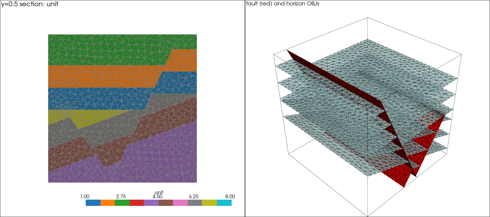

# Labelled tetrahedral meshes with MMG3D (experimental)

`make_mmg_volume.py` makes, for a benchmark case, one conforming tetrahedral
mesh of the unit cube in which every tetrahedron has a stratigraphic unit and a
fault block, plus one OBJ per fault and one OBJ per horizon. The OBJ surfaces
are faces of the volume mesh, so they share vertices with the volume and with
each other.

```sh
# from this folder, with the LoopStructural .venv; MMG 5.8 is found in
# ../fault_mmg_experiment/.mmg-runtime, or set MMG3D=/path/to/mmg3d_O3
python make_mmg_volume.py --case unconformity_faulted --reference <path>/benchmark
```

Status: tested on **`unconformity_faulted`** only (the most complex case: two
faults, one of them displaced by the other and truncated by an angular
unconformity, two series). The code also contains the logic for abutting
faults and fault tips, but no case with those features has been run yet.

## Method

MMG3D `-ls` inserts the zero set of **one** scalar field per call. The mesher
therefore makes a sequence of calls. Each call uses an `LSReferences` table:
the materials (tetrahedron references) where the surface exists are split into
two **new** references; all other materials are `nosplit`.

A Python material table (`materials.json`) keeps, for every MMG reference:
the side of each inserted fault, the series region, and the range of units
that the material can still contain. After the last cut, each reference has
one fault block and one unit.

Cut order, youngest structure first, so that each structure is inserted only
where it exists:

1. For each series (youngest first): its faults, in `fault_build_order`
   (younger and host faults first); then its unconformity surface. A series
   without an unconformity gets all material that is still unassigned.
2. The horizons of each series, one call per isovalue and per fault block.

Each field is the **smooth extension of one fault block** (`fields.forced_sides`),
evaluated with LoopStructural at the current MMG vertices. The field is never
sampled across a fault, so there is no smearing. An abutting fault is cut only
in materials on its host side. A fault that an unconformity truncates is cut
only in the material below that unconformity. A fault with a tip is cut as its
full extension `gx = 0` plus a tip surface `t = 0` in the footwall; the
footwall block is `gx < 0, t > 0` (not yet tested).

Surfaces come from tetrahedron faces between materials: a fault face separates
two different sides of that fault; a horizon face separates two materials of
the same fault block with units on each side of the isovalue.

After each cut MMG remeshes the whole mesh (`-hsiz 0.05 -hausd 0.002
-hgrad 1.4`). A last `-optim` pass improves quality. `--no-adapt` gives pure
cuts (`-noinsert -nomove -noswap`): exact, but with slivers.

## Outputs per case

| File | Content |
| --- | --- |
| `volume.vtu` | Tetrahedra. Cell data: `unit`, `series`, `block:<series>`, `side:<fault>`, `material` (MMG reference), `quality`, `min_dihedral_deg` |
| `volume.mesh` | Same mesh, Medit format, reference = material |
| `materials.json` | Unit table, material table (reference → sides, region, unit), and the lineage of every reference |
| `surfaces/fault_<f>.obj` | One surface per fault (normal toward the hanging wall) |
| `surfaces/horizon_<series>_<k>.obj` | One surface per horizon (normal toward the younger unit); same names as the benchmark |
| `surfaces/*.vtp` | Same surfaces with cell data `block` |
| `report.json` | Volume and surface QA, and every MMG call (command, time, size) |

## Result: `unconformity_faulted`

Starting grid 20³ Kuhn cube; 19 MMG calls (4 horizon cuts were skipped because
the horizon does not cross that fault block); 57 s model build, 217 s meshing.

| Check | Result |
| --- | --- |
| Vertices / tetrahedra | 22,265 / 121,364 |
| Total volume | 1.000000000000 |
| Unlabelled tets, inverted tets, faces with >2 tets, cracks (boundary faces not on the cube) | 0, 0, 0, 0 |
| Interfaces between materials that are not a fault or a horizon | 0 |
| Surfaces | 9 of 9 reference surfaces (2 faults, 3 cover, 4 basement horizons) |
| Area against the benchmark reference surfaces | max relative difference 3.8e-5 |
| Vertex distance to the implicit surface | max 1.6e-4 (`fault_f_pre`), ≤ 4e-5 for all others |
| Surface boundary conformity | every inner boundary edge of each surface is an edge of another surface (0 orphan edges); `f_pre` ends on `f_post` and on the unconformity |
| Element quality (MMG normalised) | min 0.024, median 0.82; 145 tets below 0.1 |
| Minimum dihedral angle | 1.3°; 92 tets below 5° (86 in unit 4, the lowest basement unit) |

Unit 0 (cover below the unconformity) is empty, as in the benchmark unit table:
the basement takes that region.



## Shortcomings of MMG for this task

Observed in this work or in `../fault_mmg_experiment` (MMG 5.8.0, CLI):

1. **One field and one isovalue per call.** There is no multi-level-set or
   multi-isovalue mode. This case needs 19 calls; a case with *n* horizons and
   *b* fault blocks needs about *n·b* calls.
2. **One value per vertex.** A faulted field is discontinuous, so it cannot be
   given in one call. Each fault block needs its own call with a smooth
   extension field, and `nosplit` on all other blocks. The vertices on the
   fault get the value of the active block only.
3. **Each call remeshes the whole mesh.** There is no local mode for `-ls`, so
   the time per call grows with the mesh (4 s → 15 s here). Most of the 217 s
   is spent remeshing material that the cut does not touch.
4. **No interface can end inside the volume.** An `-ls` interface is always a
   closed boundary between materials. A fault tip therefore needs a
   non-geological extension and cap, which add interfaces and bad elements.
   `-opnbdy` (keep input triangles between two domains of the same reference)
   could be an alternative; it is not tested.
5. **Material references must be managed outside MMG.** Each split needs
   fresh references (reusing one breaks the inverse map), and the meaning of
   each reference is not stored in the mesh. The CLI also gives every new
   interface triangle reference 10, so earlier interfaces must be re-tagged.
6. **Adaptation moves interface vertices.** With remeshing on, vertices move
   along MMG's own surface approximation within `hausd` (here up to 1.6e-4 from
   the true fault). Without remeshing the cut is exact but the mesh has
   slivers (min quality 0.006 after one planar cut).
7. **Poor elements can change the level set.** In `fault_mmg_experiment`,
   MMG's pre-pass forced level-set signs around tets with quality below 1e-6
   and returned success with a wrong horizon. Every result must be checked
   independently; MMG's exit code is not enough.
8. **Required triangles are not fixed when a level set crosses them**
   (`fault_mmg_experiment`): you cannot freeze an interface and cut another
   block separately, then join the two meshes.
9. **Quality near junctions.** Bad tets remain where interfaces meet at small
   angles (here minimum dihedral angle 1.3°). MMG cannot move the vertices on a
   junction line, so it cannot repair these tets fully.
10. **File-based interface.** The CLI needs ASCII Medit files for every call
    (the Windows conda build has no Python bindings), which adds IO time.

## Next steps

- Run the other cases, in particular `fault_tip` (tip cap) and `y_junction`
  (abutment), which use code paths that are not tested yet.
- Reduce calls: cut all isovalues of one block in one call with a sawtooth
  field `(-1)^k (v - iso_k)`, and relabel by centroid value afterwards.
