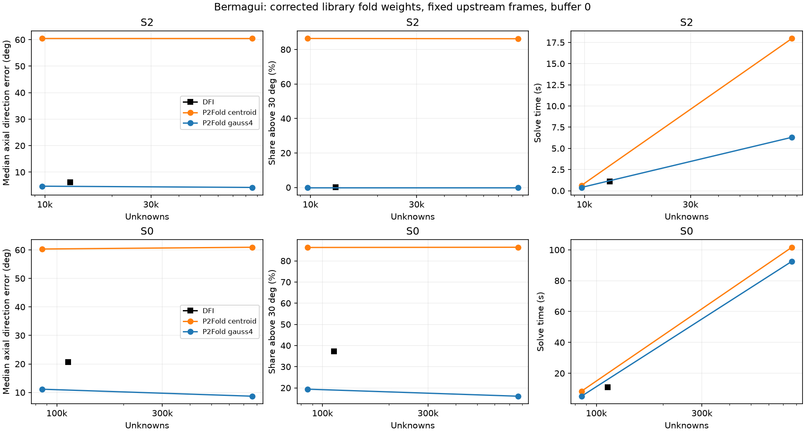
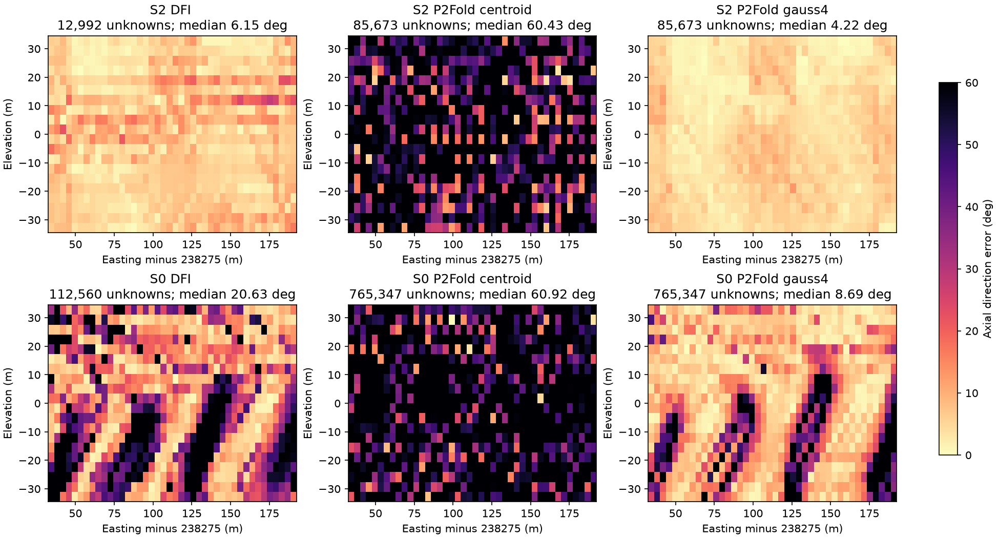
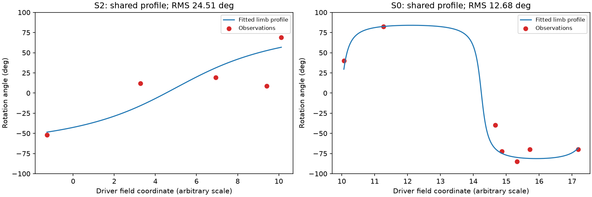

# P2Fold Bermagui validation - 20 October 2026

The phase 4 decision gate passes for both S2 and S0: library `P2Fold` with
`gauss4` has lower median fold-direction error than DFI with fewer unknowns.
This supports using gauss4 for this sparse fold-modelling problem. It does not
establish a universal ranking or independent geological accuracy.

At the smaller budget, S2 improves from 6.15 to 4.69 degrees with 25.3% fewer
unknowns; S0 improves from 20.63 to 11.14 degrees with 23.9% fewer unknowns.
S0 still has 19.4% of inner probes above 30 degrees (DFI: 37.3%). The largest S0
gauss4 mesh lowers that share to 16.1% and the median to 8.69 degrees, at much
higher cost. Unregularised centroid sampling is unstable and is not recommended.

## Corrected measurements

| Target | Engine / rule | Requested `nelements` | Unknowns | Tets | Median (deg) | Above 30 deg (%) | Solve (s) | Peak RSS (MiB) |
|---|---|---:|---:|---:|---:|---:|---:|---:|
| S2 | DFI | 10,000 | 12,992 | 56,420 | 6.15 | 0.009 | 1.11 | 666 |
| S2 | P2Fold centroid | 1,000 | 9,711 | 5,850 | 60.44 | 86.378 | 0.63 | 408 |
| S2 | P2Fold gauss4 | 1,000 | 9,711 | 5,850 | 4.69 | 0.000 | 0.39 | 416 |
| S2 | P2Fold centroid | 10,000 | 85,673 | 56,420 | 60.43 | 86.230 | 17.97 | 505 |
| S2 | P2Fold gauss4 | 10,000 | 85,673 | 56,420 | 4.22 | 0.000 | 6.30 | 1008 |
| S0 | DFI | 100,000 | 112,560 | 525,690 | 20.63 | 37.282 | 11.01 | 3726 |
| S0 | P2Fold centroid | 10,000 | 85,673 | 56,420 | 60.30 | 86.324 | 8.40 | 505 |
| S0 | P2Fold gauss4 | 10,000 | 85,673 | 56,420 | 11.14 | 19.379 | 5.14 | 1009 |
| S0 | P2Fold centroid | 100,000 | 765,347 | 525,690 | 60.92 | 86.431 | 101.66 | 2187 |
| S0 | P2Fold gauss4 | 100,000 | 765,347 | 525,690 | 8.69 | 16.060 | 92.55 | 6760 |

All ten candidate solves converged under the pinned CG stopping rule and all
35,280 inner probes per candidate were finite. Peak RSS is the whole fresh worker
process high-water resident set, including loading the shared drivers, building,
solving and evaluation; it is not Python-only allocation or incremental solver
memory. Solve timing wraps `solve_system` and includes its matrix assembly;
`build_seconds` in the JSON also includes profile fitting and constraint setup.
Timings are single observations on a shared machine, not a performance guarantee.
The largest gauss4 S0 run used about 6.6 GiB peak RSS and 92.5 s in `solve_system`.

## Protocol and reproducibility

Library code: `b1ca2cd7165ac1a0c0c7be2073225b73a62e2fd1`. Environment:
Windows 11, Python 3.13.12, NumPy 2.4.6, SciPy 1.18.0, pandas 3.0.5.
The scripts use the library factory (`interpolatortype="P2Fold"`); no prototype
class, engine replacement or library monkeypatch is used. The per-instance solve
wrapper measures time and rejects a nonconverged solve without changing the
linear system or solver arguments.

- Data: external Honours project, `Data/Processed/TrimDataS4.csv`, `TrimDataS3.csv`,
  `TrimDataS2.csv`, `TrimDataS0_LA2.csv`. No source CSVs are committed. File hashes
  are in [inputs.json](inputs.json).
- Box: (238275, 5965000, -50) to (238500, 5965250, 50). All candidates use explicit
  `buffer=0.0`. S4 and S3 retain the prototype's explicit 0.5 and 0.3 buffers.
- Python, NumPy and the package RNG are reset to seed 12345. A single prepared DFI
  S4 -> S3 -> S2 chain is saved, then loaded fresh by every candidate process.
  S2 candidates use the same S3 driver; S0 candidates use the same DFI S2 driver.
  This isolates the target interpolator, instead of changing the S0 fold model
  when the S2 engine changes. It is not an end-to-end all-P2 chain benchmark.
- S2 uses `limb_wl=80`, averaged fold axis. S0 uses `limb_wl=None` (automatic fit)
  and fixed axis (-0.31882007, -0.46674375, -0.06258398).
- Every candidate for a target has the same fitted profile parameters and the
  same hash of expected probe normals (rounded to 8 decimal places). The summary
  refuses to pass the gate if those hashes, or the buffers, differ.
- CG: `maxiter=20000`, `rtol=1e-8`; the library also applies its data-dependent
  absolute tolerance. Default fold-family weights are 10, 10, 1. The model builder
  sets isotropic `cgw=0`; DFI retains its default directional fold regularisation.
- Metric follows the prototype: `acos(abs(unit(gradient) . unit(cross(fdir,axis))))`
  in degrees. This is an **axial orientation** error in [0,90], not a signed
  polarity test. Samples come from the inner 70% of each axis of a 60 x 60 x 30
  grid, avoiding boundary NaNs. The metric measures agreement with the fold event,
  not agreement with independent geological truth.

From the repository root, with the workspace packages on `PYTHONPATH`:

```powershell
$env:PYTHONPATH="$PWD;$PWD/packages/loop_common/src;$PWD/packages/loop_interpolation/src"
python scripts/validation/p2_fold_bermagui.py --project 'C:/Users/lachl/scratch/bonnie/Honours_model23.09'
python scripts/validation/summarise_p2_fold.py validation/p2_fold/runtime
```

The runtime directory contains the shared driver cache, full logs and probe
arrays and is ignored by Git. Individual workers can be rerun with `--mode worker`,
`--target S2|S0`, `--engine DFI|P2Fold`, `--rule centroid|gauss4` and `--nelements N`.
Use the same prepared drivers and output directory for one comparison.

## Interpretation and differences from the prototype

The old handoff's 4-8 degree gauss4 and 6-12 degree DFI ranges are historical
single-run prototype observations, not acceptance bounds for this run. They are
superseded by the table above for the corrected library implementation.

The prototype applied sample weight `w/n_samples`; its gauss4 family energy was
one quarter of centroid's. The library now applies `w*sqrt(q_i)` after row
normalisation. On gauss4 this doubles the residual weight and quadruples its
squared contribution relative to that prototype. A common tetrahedron-volume
factor cancels under row normalisation and was removed. These corrections do not
imply equal residual energy for every field under two different sampling rules.

This run also pins a single upstream **DFI** chain and an automatic S0 profile.
The old full-resolution auto example used a **P2** S2 driver; its S0 6.20 degree
median and 0.94% tail cannot be compared as if only quadrature changed. Different
upstream fields change the fitted S0 profile and the expected direction field.
The new S0 fit has 12.68 degree RMS residual modulo 180 degrees; S2 has 24.51
degrees, consistent with contradictory sparse observations. Compare candidates
inside this run; do not attribute differences between historical runs solely to
weight corrections.

Centroid has about 60 degree median error at both resolutions and mean gradient
norms of millions. Converged CG alone therefore does not establish a usable
field. With `cgw=0`, one fold sample per tetrahedron does not control the varying
P2 gradient adequately. This is an observed failure of this configuration, not
an assertion that every regularised centroid model behaves this way. No
regularisation sweep was performed; this phase does not change the solver or
regularisation policy.

A factory `nelements` request is currently a **structured-grid cell budget**,
not a literal tetrahedron or unknown count. Each cell splits into five tets.
For this box, requests of 1e4 and 1e5 realise 56,420 / 525,690 tets and
85,673 / 765,347 P2 unknowns. The older wording "nelements is tets" was inaccurate.
The budget-matched P2 requests are consequently 1e3 and 1e4. Inspect actual
`support.n_elements` and `dof`; equal `nelements` requests are not equal cost.

Field scale remains arbitrary: the gauss4 mean gradient norms are about 0.11-0.45,
rather than the nominal norm target of one. Do not treat the field as a distance
function or transfer a wavelength in field units between independently fitted
models. The buffer issue, lower-face NaNs (F2), amplitude damping (F3), and
rotation-profile local minima remain open. This phase leaves them unchanged.

## Reviewed figures





The sections compare the full requested meshes, not the reduced-budget gate
meshes. S2 gauss4 errors are low across the section; S0 retains spatial bands of
large errors near rapid profile transitions. Both centroid sections show poor
agreement throughout. The shared profiles are plotted with their observations:



## Checks and release scope

The gate tests reject larger P2 meshes, different buffers and different fold
geometry. The bundled synthetic example is
`examples/2_fold/plot_3_p2_fold.py`, independent of the external data.
No golden baselines or numerical interpolation code are changed by this phase.
The mesh-size log message and API docstrings are corrected to describe cell budgets.

The existing phase 0-3 commits use conventional prefixes and have no
`Co-Authored-By` trailers. Release-please's currently open PRs were inspected:
[#348](https://github.com/Loop3D/LoopStructural/pull/348) changes only the root
manifest entry, changelog and version;
[#347](https://github.com/Loop3D/LoopStructural/pull/347) changes only loop-common's
entry and package files; [#344](https://github.com/Loop3D/LoopStructural/pull/344)
changes only loop-interpolation's entry and package files. No map2loop or
visualisation release is involved. Recheck after this documentation PR merges;
this pre-merge inspection does not complete the post-merge release task.
Phase 5 remains a separate follow-up after the phase 4 documentation is merged.


Validation checks for this PR:

- Interpolation golden, registration, P2Fold and quadrature tests: **172 passed,
  9 skipped, 2 expected failures in 25.18 s**. No golden files were regenerated.
- Gate unit tests and model integration: **9 passed in 9.34 s**.
- Bundled P2Fold example: executed successfully against the worktree sources.
- Four new Python files formatted with Black.
- Sphinx HTML build succeeded with gallery execution disabled; 286 warnings
  were reported elsewhere in the documentation. The new fold page, its headings,
  actual-count table and generated example link were inspected in the HTML.
  This build does not claim to have executed every existing gallery example.


**Release follow-up:** root `pyproject.toml` currently declares
`loop-common>=0.0.1,<0.1.0` and `loop-interpolation>=0.0.1,<0.1.0`. Both reject
the pending 0.1.0 package releases (checked with `packaging` specifiers). The root
release PR currently changes the version, not those ranges. Align dependency
requirements and the lockfile with the new package releases before publishing
the root release; the workspace-based validation does not prove compatibility
of the published dependency set. This phase does not manually bump package
versions or merge release PRs. Post-merge release readiness remains incomplete.

Phase 4 documentation and validation PR: [#349](https://github.com/Loop3D/LoopStructural/pull/349).
Merge and post-merge release checks remain pending.
